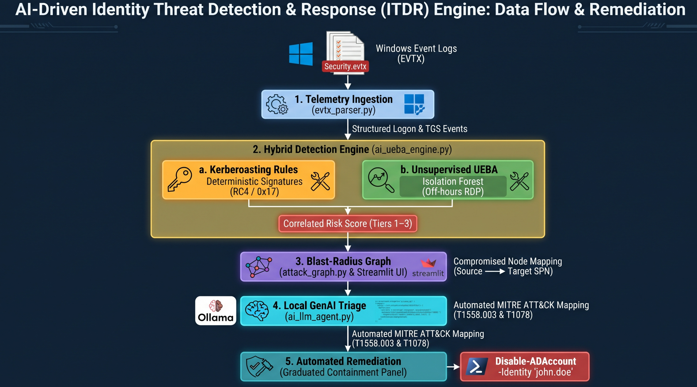
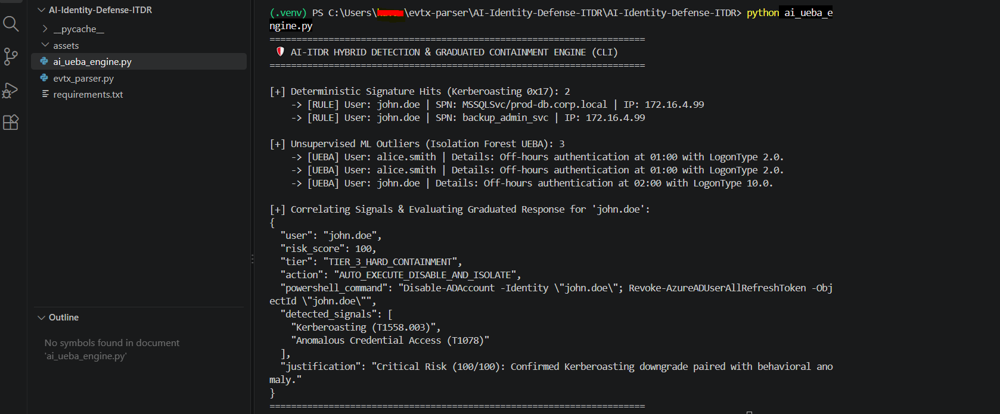
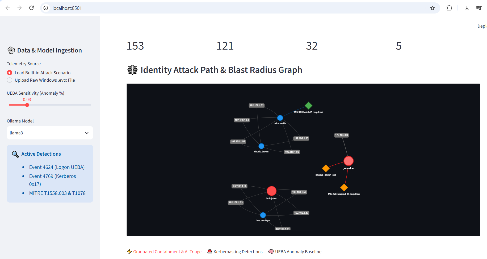
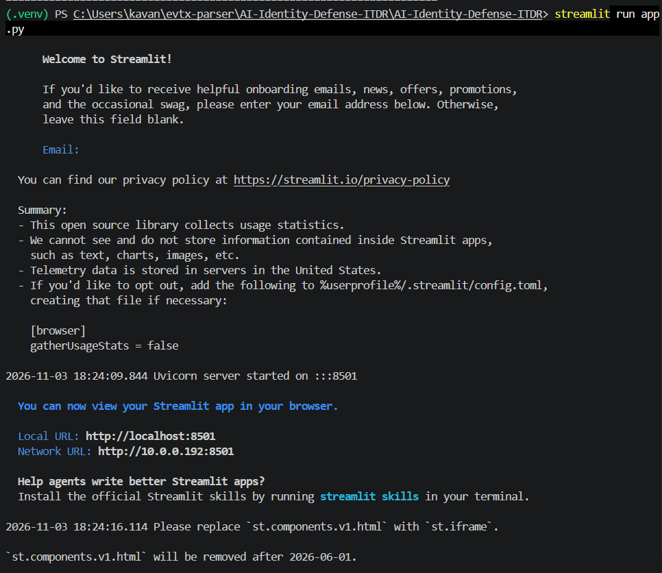
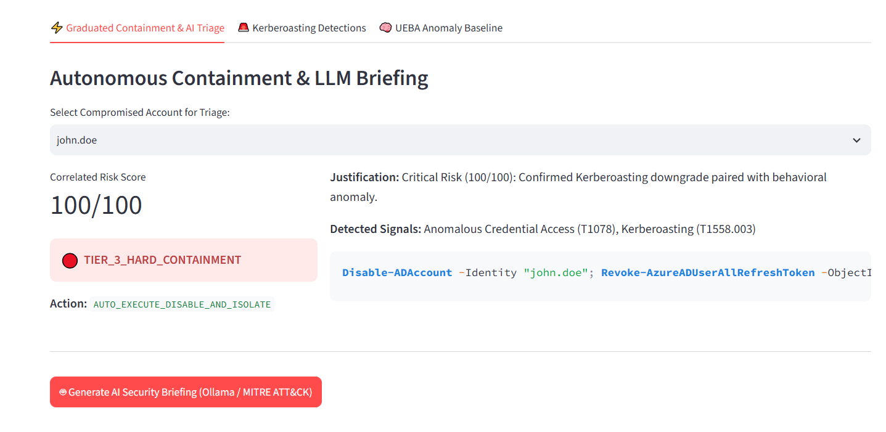
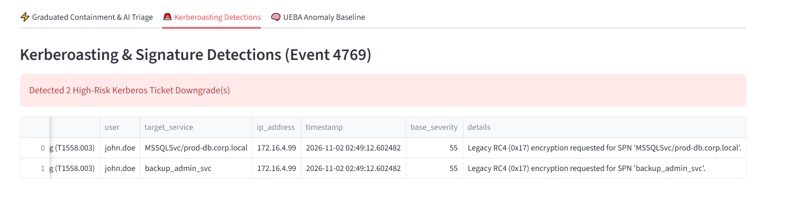
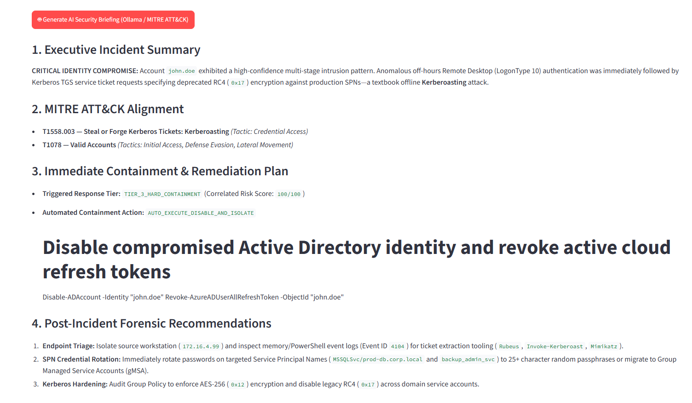
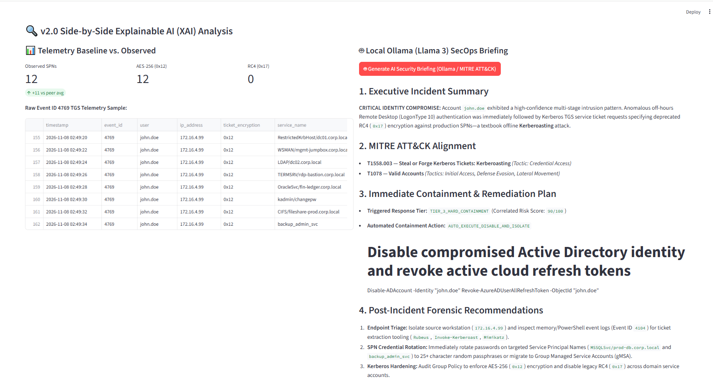
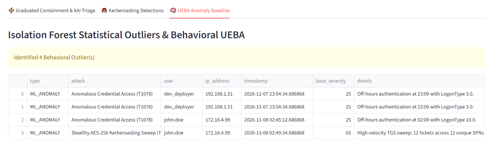
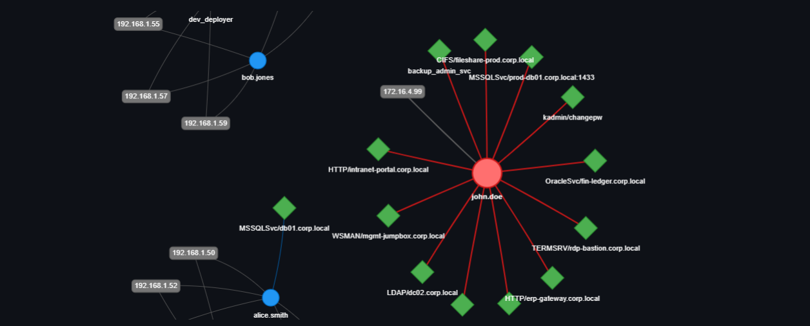

# 🛡️ AI-Driven Identity Threat Detection & Response (ITDR) Engine

## 💡 What is this project?

Securing modern **Active Directory (AD)** environments is one of the toughest challenges in enterprise cybersecurity. Attackers frequently use stealthy credential theft techniques—ranging from legacy RC4 (`0x17`) downgrades to advanced **AES-256 (`0x12`) Kerberoasting sweeps** and off-hours lateral movement—that easily bypass traditional signature-based security tools.

**AI-Driven Identity Threat Detection & Response (ITDR) (v2.0)** is an autonomous security watchdog built to close this visibility gap. Acting as an early-warning and automated containment system for your domain controllers, it executes four critical functions:

1. **Watches & Ingests:** Continuously parses Windows Event telemetry (such as Event ID `4624` logons and Event ID `4769` Kerberos TGS ticket requests).
2. **Detects Stealthy Anomalies:** Combines deterministic signature rules with unsupervised machine learning (`IsolationForest` UEBA) to catch both known attack patterns and zero-signature behavioral anomalies—including high-velocity AES-256 SPN sweeps and off-hours RDP (`Type 10`) logons.
3. **Maps the Blast Radius:** Generates an interactive **PyVis network graph** so analysts can visually trace lateral movement from compromised endpoints to high-value Service Principal Names (SPNs).
4. **Explains, Triages & Contains Locally (XAI + GenAI):** Pairs **Explainable AI (XAI)** peer baseline comparisons with a local **Ollama (Llama 3)** agent to generate privacy-first incident briefings mapped to **MITRE ATT&CK (`T1558.003`, `T1078`)**, complete with graduated PowerShell remediation scripts (`Disable-ADAccount`) without ever exposing sensitive corporate logs to external cloud APIs.
---

## 📐 System Architecture & Remediation Flow


---

## 📸 Project Visuals & Execution

### 1. Hybrid Detection Engine (CLI)

*Running the detection engine locally to correlate deterministic Kerberoasting rules and Isolation Forest UEBA anomalies, scoring compromised identity `john.doe` at 100/100.*

### 2. Identity Attack Path & Blast Radius Graph

*Interactive PyVis blast-radius visualization mapping source RDP compromise nodes to targeted production Service Principal Names (SPN diamonds).*


*Streamlit web launch and dashboard interface showcasing live SOC controls.*

### 3. Graduated Containment Panel

*Automated Tier 3 hard containment evaluating risk severity and generating pre-written PowerShell remediation scripts (`Disable-ADAccount`).*


*Granular breakdown of Kerberoasting signature triggers and behavioral UEBA risk indicators.*

### 4. Local AI SecOps Incident Briefing

*Generated local LLM (Ollama / Llama 3) security briefing outlining executive summary, MITRE ATT&CK alignment, and forensic recommendations.*
### 5. 🆕 v2.0 Upgrade: Stealthy AES-256 Detection & Explainable AI (XAI)

Here is a look at the v2.0 architecture in action, stress-testing the engine against advanced AES-256 (`0x12`) Kerberoasting sweeps where legacy signature rules are bypassed:

**1. Side-by-Side Explainable AI (XAI) & Local Ollama Llama 3 Briefing:**

*Comparing historical peer baseline deltas and raw Event ID `4769` logs directly beside the autonomous Ollama Llama 3 SecOps report.*

**2. Behavioral UEBA & High-Velocity TGS Sweep Detection:**

*Isolation Forest engine catching the high-velocity 12-ticket SPN sweep with a 65 base severity score with zero legacy RC4 signature hits.*

**3. Attack Path & Blast Radius Visualization:**

*PyVis attack path graph mapping the compromised `john.doe` account targeting 12 unique production service principal names.*

---

## 🏗️ Architecture & Features

1. **Telemetry Ingestion Layer (`evtx_parser.py`)**: Parses raw Windows Event logs or enterprise baseline templates (Events `4624` for successful logons and `4769` for Kerberos TGS requests).
2. **Hybrid Detection Engine (`ai_ueba_engine.py`)**: 
   * **Deterministic Signatures:** Flags offline Kerberoasting attempts by identifying weak RC4 (`0x17`) ticket encryption requests on non-machine accounts.
   * **Unsupervised UEBA:** Utilizes scikit-learn's `IsolationForest` on logon hours, weekdays, and logon types (e.g., Type 10 RDP off-hours) to detect statistical behavioral anomalies.
   * **Graduated Response Scoring:** Correlates rule hits and UEBA anomalies into Tiers 1 through 3, automatically generating PowerShell containment commands.
3. **Interactive Blast-Radius Graph (`attack_graph.py`)**: Renders dynamic network graphs mapping source IPs, user identities, and target SPN assets.
4. **Local GenAI Triage Agent (`ai_llm_agent.py`)**: Integrates with local Ollama (`llama3`) to synthesize automated incident reports mapped directly to **MITRE ATT&CK (`T1558.003` & `T1078`)**.
5. **Streamlit Web Dashboard (`app.py`)**: A modern SOC analyst interface providing live metrics, interactive tabs, and autonomous containment controls.

---

## ⚙️ Prerequisites

* **Python 3.9+**
* **Ollama** installed locally. Before running the pipeline, ensure the Llama 3 model is pulled and running:
  ```bash
  ollama pull llama3
  ollama run llama3
  
## 🚀 Quick Start

1. **Clone the repository:**
   ```powershell
   git clone https://github.com/Kavana-as/AI-Identity-Defense-ITDR.git
   cd AI-Identity-Defense-ITDR
   ```

2. **Create and activate a virtual environment:**
   ```powershell
   python -m venv .venv
   .venv\Scripts\Activate.ps1
   ```

3. **Install dependencies:**
   ```powershell
   pip install -r requirements.txt
   ```

4. **Run the hybrid detection engine (CLI):**
   ```powershell
   python ai_ueba_engine.py
   ```

5. **Launch the Streamlit SOC Web Dashboard:**
   ```powershell
   streamlit run app.py
   ```

